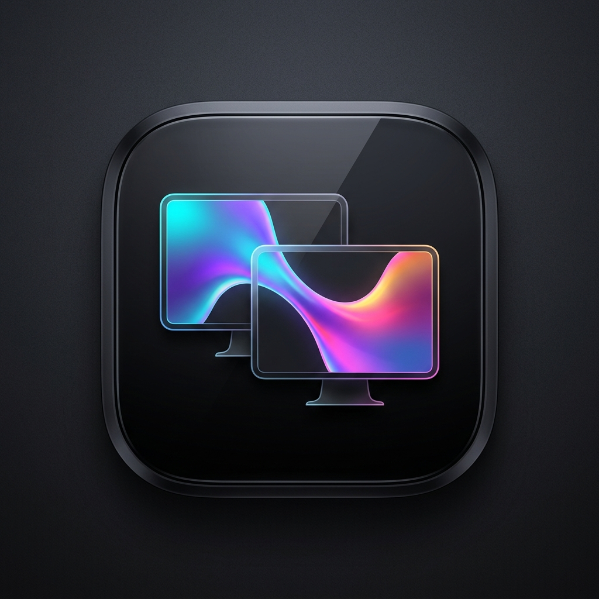

# iCorner Duo — Studio Coins Organiques & Passerelle Fluide (v2.4)

<p align="center">
  
</p>

**iCorner Duo** est un utilitaire visuel ultra-léger et moderne en **Glassmorphisme** pour Windows 10 et Windows 11. Conçu pour sublimer les configurations mono et multi-écrans, il applique des **coins d'écran arrondis organiques haute définition** sur toutes vos dalles et déploie une **passerelle liquide en verre dépoli** fluide et réactive lorsque votre curseur traverse les bordures entre vos moniteurs.

---

## 🌟 Fonctionnalités Principales

- ✦ **Coins Organiques Multi-Écrans Haute Définition** :
  - **Profils géométriques continus** : Choisissez entre la **Superellipse Hyper-Continue (n=4.2)** pour des transitions de bordure invisibles ou l'**Arc Circulaire Classique (n=2.0)**.
  - Rayon de courbure réglable en temps réel de 0 à 110 px avec aperçu spéculaire instantané.
  - Activation/désactivation indépendante de chaque angle (Haut-Gauche, Haut-Droit, Bas-Gauche, Bas-Droit).
  - **Liseré spéculaire et biseau lumineux** : Rendu optique avec bordure biseautée et halo d'ambiance personnalisables en opacité et épaisseur.
  - **Modes de résonance dynamique** : Verre dépoli fixe (0% CPU), ondulation spectrale prisme, respiration atmosphérique douce, onde boréale ou pulsation synchronisée sur le son système.

- 🌊 **Passerelle Liquide Inter-Écrans (Multi-Monitor Bridge)** :
  - Détection automatique et instantanée du passage du curseur d'un moniteur vers un autre.
  - **Effet magnétique à l'approche de la bordure** : Une onde de verre lumineuse et caustique apparaît lorsque le curseur s'approche de la jonction entre deux écrans.
  - **8 Styles visuels de transition** :
    - *Fusion Glassmorphique* (Pont Liquide + Halo Prismatique + Poussière Stellaire)
    - *Pont Liquide en Verre Dépoli*
    - *Onde Prismatique Atmosphérique*
    - *Filaments Quantiques*
    - *Nuage de Poussière Stellaire*
    - *Résonance Concentrique (Ripples)*
    - *Ligne Optique Horizon*
    - *Pulsation des Angles Cibles Uniquement*
  - Durée et amplitude de l'onde entièrement configurables.

- 🎨 **12 Palettes Chromatiques en Verre Dépoli** :
  - *Prisme Éther* (Cyan glacé, Lavande, Rose poudré, Ambre doux)
  - *Verre Givre & Argent Pur*
  - *Océan Polaire* (Azur, Cyan néon, Indigo)
  - *Émeraude & Menthe Givrée*
  - *Velours Rubis & Corail*
  - *Ambre Solaire & Champagne Chaud*
  - *Aurore Boréale Nocturne*
  - *Brume Ultraviolette*
  - *Fleur de Sakura Pastel*
  - *Monochrome Obsidienne & Titane Fumé*
  - *Spectre Chromatique Continu (360°)*
  - *Palette Personnalisée* (sélecteur de 2 teintes RVB au choix)

- 🔲 **Interface Studio Entièrement Courbée (Zéro Angle Droit)** :
  - Design cohérent avec commutateurs arrondis, curseurs tactiles, listes déroulantes et cartes en verre biseauté.
  - **Zéro scintillement (`WS_EX_COMPOSITED`)** et double-buffering intégral.
  - Intégration dans la barre des tâches système (systray) avec démarrage automatique optionnel avec Windows.

---

## 🚀 Installation & Utilisation

1. Téléchargez la dernière version **`iCornerDuo.exe`** depuis la section **[Releases](https://github.com/flobure2008-ui/iCorner-Duo/releases)**.
2. Lancez `iCornerDuo.exe` : c'est un exécutable portable autonome ne nécessitant aucune installation.
3. Configurez vos arrondis et vos transitions dans le studio, puis réduisez-le en tâche de fond dans la zone de notification.

### Compilation depuis la source (PowerShell)

```powershell
& "C:\Windows\Microsoft.NET\Framework64\v4.0.30319\csc.exe" /nologo /target:winexe /win32icon:"icon.ico" /out:"iCornerDuo.exe" /r:System.dll /r:System.Drawing.dll /r:System.Windows.Forms.dll "Program.cs"
```

---

## 📜 Licence

Projet distribué sous licence MIT.
