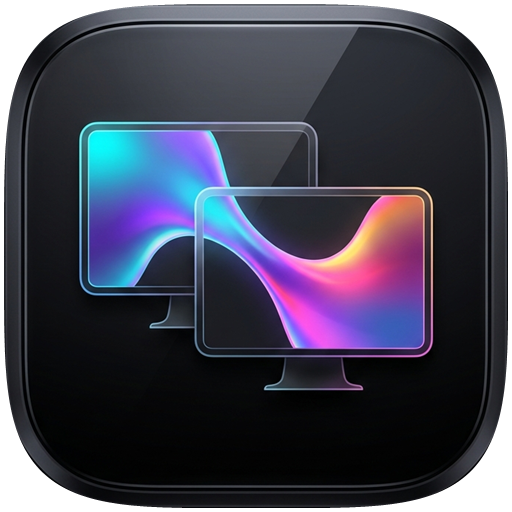

<div align="center">
  

  #  iCorner Duo — Ultimate Edition

  **Bords arrondis animés • Transitions Multi-Écrans • Dynamic Island (Musique & Minuteur Apple) • Compagnon Cyber Original • Assistant IA (Gemini, Claude, ChatGPT, Mistral)**

  [](#)
  [](#)
  [](#)
</div>

---

## ✨ Présentation

**iCorner Duo (Ultimate Edition)** est une application Windows native, ultra-complète et autonome (un seul fichier `.exe` léger, 60 FPS, 0 dépendance externe) qui regroupe :
1. **💊 Un Dynamic Island Multi-Onglets Interactif** (Musique + Minuteur/Pomodoro style Apple + Compagnon + Assistant IA) doté d'un **Système d'Apparition Intelligent** avec 5 animations d'entrée.
2. **🦊 Un Compagnon Cybernétique 100 % Original (Non-Apple)** perché sur ou à côté de votre Dynamic Island, dont les yeux suivent votre souris, qui danse sur votre musique et vous parle via des bulles de dialogue.
3. **🤖 Un Système Multi-API IA** supportant **Google Gemini, Anthropic Claude, OpenAI ChatGPT et Mistral AI** directement depuis le Dynamic Island ou le Studio.
4. **📐 Des Bords Arrondis Animés** (*Squircle* ou *Cercle*) et **🌊 8 Styles de Transitions Inter-Écrans** avec **13 Thèmes de Couleurs + Couleurs Personnalisées**.

<div align="center">
  
</div>

---

## 🚀 Fonctionnalités Complètes

### 💊 1. Dynamic Island Interactif (4 Onglets + Système d'Apparition)
Survolez le Dynamic Island en haut de votre écran pour déployer ses **4 onglets interactifs** :
- **🎵 Onglet Musique** : Détection automatique **Spotify, Apple Music, YouTube / YouTube Music**, spectre audio 12 barres en temps réel (*Windows CoreAudio*), boutons `⏮`, `⏯`, `⏭`, `🔉`, `🔊` et lancement rapide des plateformes.
- **⏱️ Onglet Minuteur & Pomodoro (Style iOS)** : Anneau circulaire orange progressif dans la pilule compacte et grand compte à rebours numérique (`1 min`, `5 min`, `🍅 Pomodoro 25 min`, `+1 min`, `Chronomètre`, `Pause/Reset`) avec alerte visuelle et sonore en fin de compte à rebours.
- **🦊 Onglet Compagnon** : Niveau, XP, humeur, caresser/booster (`+15 XP`), changer d'espèce ou de position à la volée.
- **🤖 Onglet Assistant IA** : Discussion directe avec **Gemini, Claude, ChatGPT ou Mistral**, conseils productivité, blagues geek et fenêtre de chat rapide sous le Dynamic Island.

#### 🌀 Système d'Apparition (Spawn System)
- **5 Modes de déclenchement** : *Toujours visible*, *Apparition au bord supérieur (Hot-Edge)*, *Intelligent (Auto-Smart : musique, minuteur, compagnon ou transition)*, *Uniquement aux transitions*, ou *Masqué*.
- **5 Animations d'entrée** : *💧 Goutte Liquide Élastique*, *🌊 Déploiement Rebonds*, *🌀 Portail Dimensionnel*, *⚡ Téléportation Cyber-Glitch*, *🔥 Éruption Solaire*.

---

### 🦊 2. Compagnon Cybernétique Original (6 Espèces Non-Apple)
Un compagnon animé à 60 FPS qui vit sur votre Dynamic Island :
1. **🦊 Kitsune Cyber-Fox** (Renard néon à oreilles mobiles et queues d'énergie)
2. **🐉 Draco Plasma-Dragon** (Mini dragon ailé cybernétique)
3. **👾 Specter Holo-Ghost** (Esprit holographique en lévitation avec anneau orbital)
4. **🐱 Neko Bionic-Cat** (Chat synthwave équipé d'un casque audio néon)
5. **🤖 Atlas Mecha-Drone** (Drone sphérique sci-fi à œil laser)
6. **🔥 Ignis Cosmic-Flame** (Élémentaire de feu cosmique)
- **Regard dynamique** : Ses pupilles suivent votre curseur en temps réel et clignent naturellement.
- **Réactif à la musique** : Danse en rythme avec des notes `♪` dès qu'un son joue sur votre PC.

---

### 🤖 3. Système Multi-API IA (Gemini • Claude • ChatGPT • Mistral)
Configurez votre clé API favorite dans l'onglet **5. Assistant IA** des paramètres :
- **✨ Google Gemini** (`gemini-2.5-flash`, `gemini-2.0-flash`, etc.)
- **🧠 Anthropic Claude** (`claude-3-5-sonnet-latest`, `claude-3-5-haiku-latest`, etc.)
- **🟢 OpenAI ChatGPT** (`gpt-4o-mini`, `gpt-4o`, etc.)
- **🌪️ Mistral AI** (`mistral-small-latest`, `mistral-large-latest`, etc.)
- Personnalisez le **System Prompt** de votre compagnon pour lui donner le caractère de votre choix !

---

### 📐 4. Bords Arrondis, 8 Transitions & 13 Thèmes
- **6 Animations continues des 4 angles** : *Fixe*, *Rotation Chromatique 360°*, *Respiration*, *Réactif aux Basses (Audio Beat Sync)*, *Scintillement d'Étoiles*, *Onde Néon*.
- **8 Transitions inter-écrans** : *Combo Ultime Pro*, *Apple Liquid Bridge*, *Siri Wave*, *Portail Plasma & Éclairs*, *Explosion d'Étoiles*, *Onde de Choc Sonar*, *Lame Laser Néon*, *Dynamic Island Bounce*.
- **13 Palettes + Couleurs Personnalisées** : *Apple Intelligence*, *iOS Electric Blue*, *Spotify Neon Green*, *Apple Music Rose*, *YouTube Crimson*, *Cyberpunk RGB Rainbow*, *Sunset Pro*, *Ultra Violet Nebula*, *Magma & Gold*, *Arctic Aurora*, *Sakura Pastel*, *Minimal Monochrome*, *Custom 1 & 2*.

---

## 📦 Installation & Lancement
```bash
git clone https://github.com/flobure2008-ui/iCorner-Duo.git
```
Double-cliquez sur **`iCornerDuo.exe`** (ou **`Lancer_iCornerDuo.bat`**).